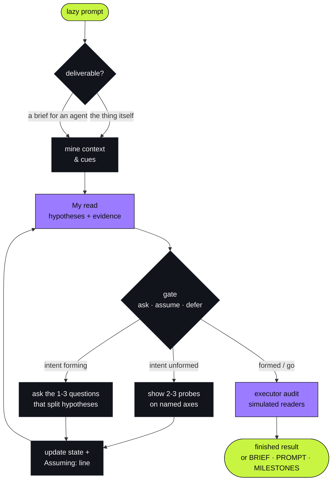

<div align="center">

<picture>
  <source media="(prefers-color-scheme: dark)" srcset="assets/banner-dark.svg">
  <source media="(prefers-color-scheme: light)" srcset="assets/banner-light.svg">
  
</picture>

<br/>

[](https://github.com/justinjd00/eazypromptin/actions)
[](.claude-plugin/plugin.json)
[](https://github.com/justinjd00/eazypromptin/stargazers)
[](https://github.com/justinjd00/eazypromptin/forks)
[](https://github.com/justinjd00/eazypromptin/commits/main)
[](https://github.com/justinjd00/eazypromptin/graphs/commit-activity)
[](LICENSE)
[](https://github.com/justinjd00/eazypromptin)

[](benchmark/RESULTS.md)
[](docs/RESEARCH.md)
[](https://agentskills.io)

<sub>WORKS WITH</sub><br/>


One line, any agent: `npx skills add justinjd00/eazypromptin`

**[Quick install](#-install)** · **[See it work](#-see-it-work)** · **[Results](#-does-it-actually-work)** · **[How it works](#-how-it-works)** · **[Research](docs/RESEARCH.md)**

</div>

---

You type *"i wanna make a game, some dungeon thing with monsters, pixel art, maybe with friends"*.

A normal assistant either guesses, or fires off a questionnaire. **EazyPromptin does what a good senior colleague does:** it tells you what it thinks you mean, shows you concrete options when you haven't decided yet, asks only the one or two questions that actually change the result, and before handing off, simulates the agent that has to build it to find what that agent would still have to guess.

```bash
npx skills add justinjd00/eazypromptin
```

## ▶ See it work

<picture>
  <source media="(prefers-color-scheme: dark)" srcset="assets/demo-dark.svg">
  <source media="(prefers-color-scheme: light)" srcset="assets/demo-light.svg">
  
</picture>

<sub>Condensed from a real session. Read the full, unedited one: [30 words → game blueprint](examples/game-dungeon-crawler.md).</sub>

<table>
<tr>
<th width="50%">Typical assistant</th>
<th width="50%">EazyPromptin</th>
</tr>
<tr>
<td valign="top">

Eight open questions at once: genre? perspective? engine version? art? multiplayer? story? scope? time?

You answer half of them. It fills the rest with its own defaults and hands back a long plan where its guesses look exactly like your decisions.

</td>
<td valign="top">

**My read:** a couch co-op roguelite you play with 1-2 friends, not a big RPG. *Could also be:* a loot crawler you play for weeks.

Three contrasting pitches to pick from, one question that splits them, a visible **Assuming:** line you can veto, an audit, and a brief where every guess is marked.

</td>
</tr>
</table>

## 📊 Does it actually work?

Blind benchmark against **the same model without the skill**. Simulated people have a **hidden intent** they only reveal when something touches it, reply tersely three times, then say "go". A separate judge scores the final result against the hidden intent without knowing which assistant is which.

| | EazyPromptin | Same model, no skill |
|:--|:--:|:--:|
| Hidden-intent items captured | **36 / 36** | 34 / 36 |
| Guesses still left for the executing agent | **3** | 8 |
| Wrong assumptions presented as fact | **0** | 2 |
| Blind preference | **4 / 4** | 0 / 4 |

The first version lost two of the four. Both losses had clear causes, both were fixed and re-measured. Method, every transcript, every verdict and the honest limits (n=4, simulated users) are in **[benchmark/RESULTS.md](benchmark/RESULTS.md)**.

## 🧠 How it works

Every round runs an **intent engine with a visible belief state**, built on 2025-2026 research on clarification and intent discovery. [docs/RESEARCH.md](docs/RESEARCH.md) maps every rule to its evidence.



<details>
<summary><b>The seven moves in detail</b></summary>

<br/>

| # | Move | What it does | Why |
|:-:|---|---|---|
| 1 | **Mine before asking** | Reads your wording ("for my boss", "with friends", "quick"), earlier messages, files, the repo. | Every question it can answer itself is one you don't have to. |
| 2 | **My read** | States its leading hypothesis, the evidence, the strongest alternative, what's open. | A wrong read costs you one word to fix. |
| 3 | **Gate** | A separate step decides: ask, assume or defer. | Separated monitors beat "ask if unclear" in agent studies. |
| 4 | **Probe or ask** | Unformed intent → 2-3 contrasting options to react to. Forming intent → the question that best splits its hypotheses. | People recognise what they want long before they can describe it. |
| 5 | **Assuming:** | The highest-impact assumptions it would build on, visible every round. | You can only veto what you can see. |
| 6 | **Executor audit** | 2-3 simulated readers list what they'd still have to guess. | Models collapse onto one wrong reading; naming assumptions catches it. |
| 7 | **Compile short** | The finished thing, or a selective brief with contracts and marked assumptions. | Long requirement lists measurably hurt agents. |

</details>

| You write | You get |
|---|---|
| "write an email to my landlord about the heating" | **Quick** · a draft right away, 1-2 questions, then the finished email |
| "landing page for my tool" | **Standard** · 2-3 rounds, then the page prompt (or the page) with its assumptions listed |
| "I want to build a game / an app / a SaaS" | **Deep** · 3-6 phased rounds, audit, then `BRIEF.md` + `PROMPT.md` + `MILESTONES.md` |
| *pastes a prompt* "the output is so generic" | Why it's generic, then a rebuild with real facts instead of adjectives |

**Answer lazily, any language:**
<kbd>1b 2a</kbd> · <kbd>go</kbd> · <kbd>decide for me</kbd> · <kbd>status</kbd> · <kbd>deeper X</kbd> · <kbd>quick</kbd> / <kbd>deep</kbd> · <kbd>back</kbd> · <kbd>run it</kbd>

## ⚡ Install

```bash
npx skills add justinjd00/eazypromptin    # any agent
```

<details>
<summary><b>Claude Code</b> (plugin, includes the gap-monitor and auditor subagents)</summary>

```
/plugin marketplace add justinjd00/eazypromptin
/plugin install eazypromptin@eazypromptin
```
</details>

<details>
<summary><b>claude.ai / Claude desktop</b></summary>

Download [`dist/eazypromptin.zip`](dist/eazypromptin.zip), then *Settings → Capabilities → Skills → Upload skill*.
</details>

<details>
<summary><b>GitHub Copilot · Gemini CLI · Codex</b></summary>

```bash
gh skill install justinjd00/eazypromptin eazypromptin               # GitHub Copilot
gemini extensions install https://github.com/justinjd00/eazypromptin  # Gemini CLI
npx skills add justinjd00/eazypromptin -a codex                       # Codex
```
</details>

<details>
<summary><b>Install script</b> (macOS, Linux, Windows)</summary>

```bash
curl -fsSL https://raw.githubusercontent.com/justinjd00/eazypromptin/main/install.sh | bash
```
```powershell
irm https://raw.githubusercontent.com/justinjd00/eazypromptin/main/install.ps1 | iex
```
Installs to `~/.claude/skills` and `~/.agents/skills`. Options: `--claude`, `--agents`, `--all`, `--project`, `--ref <tag>`.
</details>

<details>
<summary><b>ChatGPT, Gemini Gems, Mistral, API, local models</b></summary>

- **Custom GPT / Gem / agent builders:** paste [`dist/chat/instructions.md`](dist/chat/instructions.md) as instructions and upload [`dist/chat/eazypromptin-knowledge.md`](dist/chat/eazypromptin-knowledge.md) as knowledge.
- **API, Claude Projects, LM Studio, Ollama:** use [`dist/eazypromptin-full.md`](dist/eazypromptin-full.md) as the system prompt.
</details>

<details>
<summary><b>Manual</b></summary>

Copy `skills/eazypromptin/` to `~/.claude/skills/` (Claude Code) or `~/.agents/skills/` (Codex, Cursor, Gemini CLI, Copilot, opencode).
</details>

Then just ask, or call it directly with `/eazypromptin` (plugin: `/eazypromptin:eazypromptin`). In agent sessions the belief state and brief live in `.eazypromptin/<project>/` (`STATE.md`, `BRIEF.md`, `PROMPT.md`, `MILESTONES.md`).

## 🧩 Domains

Ten playbooks surface the decisions people don't know exist, with concrete option sets, smart defaults, scope traps and milestone templates.

| | | |
|---|---|---|
| 🎮 **Games** · Godot, Unity, Unreal, Roblox, web | 🌐 **Web apps & SaaS** · dashboards, tools, marketplaces | 🖥️ **Websites** · landing pages, portfolios, business sites |
| 📱 **Mobile apps** · iOS, Android, Expo | ⚙️ **Automation** · n8n, Make, Zapier, scripts, AI pipelines | 📈 **Data** · analyses, reports, spreadsheet tools |
| 🔎 **Research** · comparisons, "which X should I use" | ✍️ **Writing** · emails, applications, posts, docs | 🛠️ **Code changes** · bugs, performance, refactors |
| 🎨 **Design & UI** · screens, design systems, slides | ➕ **Your domain** · [add a playbook](#-contributing) | |

<details>
<summary><b>Repository structure</b></summary>

```
skills/eazypromptin/
├── SKILL.md                    # the loop: deliverable, read, gate, move, update, audit, compile
└── references/
    ├── intent-engine.md        # hypotheses, slots, formedness, correlated dimensions, cue mining
    ├── question-selection.md   # splitting hypotheses, answerability filters, budgets, interviewer mistakes
    ├── probes.md               # show-don't-ask: variants on named axes, sample outputs, mockups, greyboxes
    ├── executor-audit.md       # simulated readers list what they'd have to guess
    ├── brief-format.md         # selective specs, contracts, spec vs. plan, milestones with drift checks
    ├── prompt-craft.md         # rules for the final prompt
    ├── agent-prompts.md        # extra slots when an agent executes
    ├── discovery-method.md     # phase order and interview techniques for Deep mode
    └── domains/                # one playbook per kind of work
agents/                         # Claude Code subagents: gap-monitor, executor-auditor
benchmark/                      # scenarios, simulator, judge, transcripts, results
docs/RESEARCH.md                # every rule mapped to its 2025-2026 evidence
dist/                           # builds for claude.ai, chat models and single-file prompts
assets/                         # README artwork (generated by scripts/make_assets.py)
```
</details>

## 🤝 Contributing

- **New domain:** copy [`_template.md`](skills/eazypromptin/references/domains/_template.md), fill it in, add a row to the routing table in `SKILL.md`.
- **Build:** `python3 scripts/build.py` regenerates `dist/`; CI fails if it's stale or the skill doesn't validate.
- **Benchmark:** add a scenario with a hidden intent card in [`benchmark/scenarios/`](benchmark/scenarios/) and run it against the simulator and judge prompts.
- **Evidence:** know a paper that supports or contradicts a rule? Open an issue; [docs/RESEARCH.md](docs/RESEARCH.md) is meant to grow.

## ⭐ Star history

<div align="center">
<a href="https://star-history.com/#justinjd00/eazypromptin&Date">
  <picture>
    <source media="(prefers-color-scheme: dark)" srcset="https://api.star-history.com/svg?repos=justinjd00/eazypromptin&type=Date&theme=dark">
    <source media="(prefers-color-scheme: light)" srcset="https://api.star-history.com/svg?repos=justinjd00/eazypromptin&type=Date">
    
  </picture>
</a>
</div>

<div align="center">

<a href="https://github.com/justinjd00/eazypromptin/graphs/contributors"></a>

<sub>MIT licensed · built by <a href="https://github.com/justinjd00">@justinjd00</a> · if it read your mind, leave a ⭐</sub>

</div>
